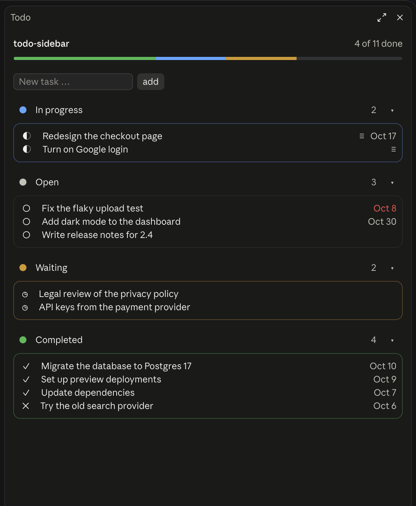
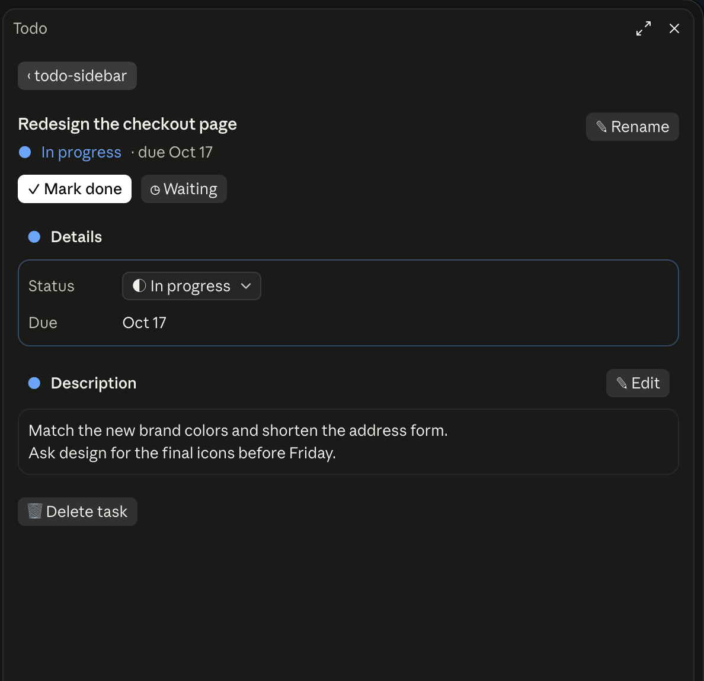
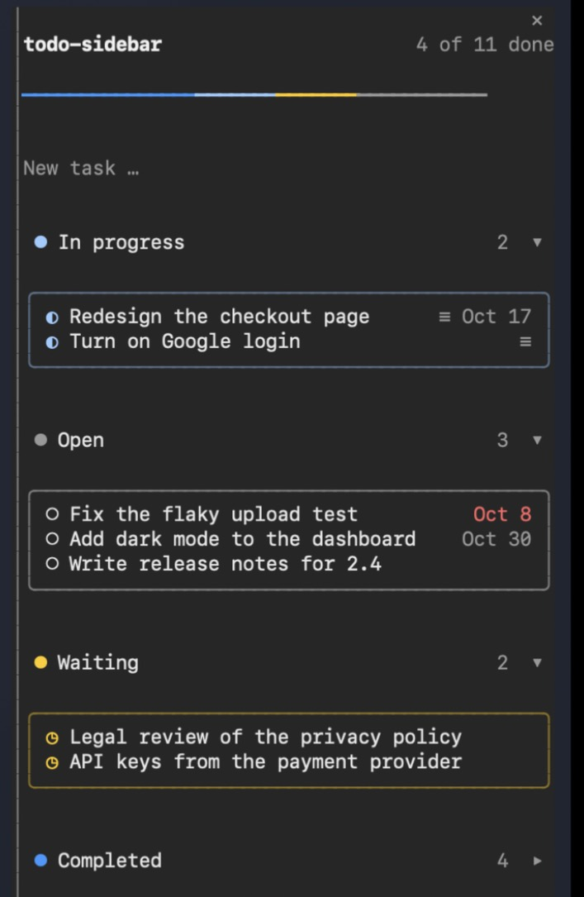
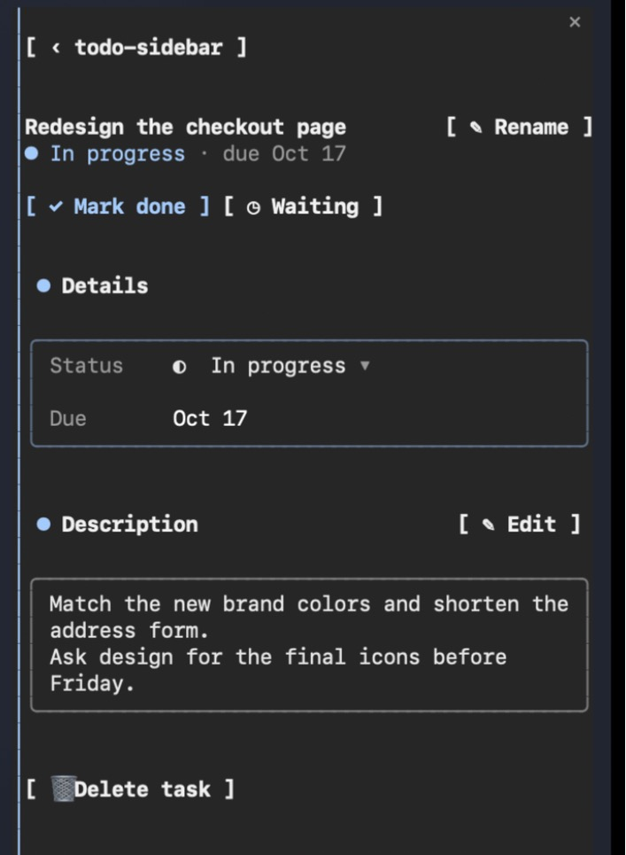

# todo-sidebar

A todo list for each project, shown in a sidebar in Claude Code. You and Claude
work on the same list. It is a plain `todos.md` in the project folder, so you
can also edit it by hand, keep it in git or leave it out.

| The list | An item |
| --- | --- |
|  |  |

It works in the terminal too:

| The list | An item |
| --- | --- |
|  |  |

- **A sidebar pane.** It opens when a session starts and shows open items
  grouped by status (in progress, open, waiting). Click a status heading to
  fold its items away or show them again. Completed items are folded away
  below them.
- **Add, open and edit items.** Type a title and press Enter to add one. Click
  an item's status icon to pick another status from the list that opens under
  it. Click the title to open the item. Its page has buttons for the likely
  next step (**▶ Start**, **✓ Mark done**, **↺ Reopen**), **✎ Rename** for the
  title, and a picker for any status. The description is a field of several
  lines, saved as you type. **🗑 Delete task** asks before it deletes.
- **Five statuses:** open, in progress, waiting, done and dropped. An item can
  also have a due date, and an overdue item is shown in red.
- **Claude can use it.** The plugin gives Claude a `todo` tool. Ask it to "add
  this to the todo list", "what's left on the list?" or "mark the login task
  done", and Claude updates the list as it starts and finishes work on it.
- **Worktrees share one list.** A session in a desktop worktree
  (`<project>/.claude/worktrees/<name>`) uses the project's own `todos.md`.

## Install

Run this at the prompt of a Claude Code session in a terminal:

```
/plugin install todo-sidebar --marketplace stoumann/todo-sidebar
```

Answer `y` to add the marketplace, then pick a scope. With the **user** scope
the plugin is on in all your projects. It starts working right away, with no
restart needed.

You have to install from a terminal: the `/plugin` command is not available in
the desktop app's Code tab. After a user-scope install, the plugin also loads
in local sessions that the desktop app starts, and its sidebar shows up there.

### Update or remove

```
claude plugin update todo-sidebar@stoumann
```

```
claude plugin uninstall todo-sidebar@stoumann
```

## Use

The sidebar opens by itself. If you have closed it, open it again with:

```
/todo-sidebar
```

### The file

The list is kept in `todos.md` at the project root. The plugin creates the file
the first time you add an item. A status is written in the checkbox:

| Mark  | Status      |
| ----- | ----------- |
| `[ ]` | open        |
| `[/]` | in progress |
| `[>]` | waiting     |
| `[x]` | done        |
| `[-]` | dropped     |

```markdown
# Project Todos

## Active
- [/] Turn on Google login | Due: 01/15/2027
  Google Cloud: OAuth client with a redirect.
  Then set the provider in the deploy settings.
- [ ] Ship to production

## Completed
- [x] Import the holiday events | Done: 10/09/2026
```

- A description is made of the indented lines under an item, written in
  markdown.
- Dates are written as `MM/DD/YYYY`. `YYYY-MM-DD` is also read.
- Open items are listed under `## Active`. Completed and dropped items move to
  the top of `## Completed`.
- An edit only changes the item it is about. Other headings and notes in the
  file stay exactly as you wrote them.
- The sidebar checks the file every two seconds, so it picks up changes you
  make in an editor.

## Develop

Load the plugin from a checkout for one session:

```
claude --plugin-dir /path/to/todo-sidebar
```

Run the tests, and check the manifest and the hooks module:

```
claude plugin test .
```

```
claude plugin validate .
```

When the plugin is loaded from its folder, Claude Code writes its type
declarations to `.claude-plugin/types/`, and `tsconfig.json` extends them, so
`tsc -p .` type-checks the plugin.

## License

MIT
